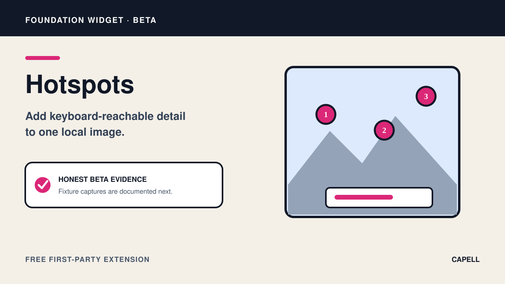

# Hotspots Widget

<!-- prettier-ignore-start -->

## What This Plugin Adds

Hotspots Widget is an **Available**, **No schema impact** Capell package in the **Capell Foundation** product group. It ships as `capell-app/widget-hotspots` and extends these surfaces: admin, frontend.

Hotspots adds a Layout Builder widget for placing bounded, accessible points over a local image. Each point can expose supporting content or an approved lazy widget target.

Editors position and label hotspots in Layout Builder, and visitors can inspect those points from the public image using the provided interaction controls.

Evidence: [`src/Filament/HotspotsWidget.php`](src/Filament/HotspotsWidget.php), [`resources/views/widget.blade.php`](resources/views/widget.blade.php), [`tests/Feature/WidgetHotspotsTest.php`](tests/Feature/WidgetHotspotsTest.php), [`capell.json`](capell.json).

Status details:

- Status: Available
- Tier: free
- Bundle: foundation
- Composer package: `capell-app/widget-hotspots`
- Namespace: `Capell\WidgetHotspots`
- Theme key: not applicable

## Why It Matters

**For developers:** The typed extension validates coordinate bounds, point limits, local media, and registry-backed targets before public rendering.

**For teams:** Teams can annotate products, diagrams, or places directly on an image without building a custom interactive map.

Evidence: [`src/Providers/WidgetHotspotsServiceProvider.php`](src/Providers/WidgetHotspotsServiceProvider.php), [`src/Filament/HotspotsWidget.php`](src/Filament/HotspotsWidget.php), [`tests/Feature/WidgetHotspotsTest.php`](tests/Feature/WidgetHotspotsTest.php), [`resources/views/widget.blade.php`](resources/views/widget.blade.php).

## Screens And Workflow

Screenshot contract: `docs/screenshots.json`.

- Hotspots Widget extension card (marketplace, required).
- Hotspots fields in Layout Builder (admin, optional).
- Hotspots public output (frontend, optional).

## Technical Shape

- Service providers: `Capell\WidgetHotspots\Providers\WidgetHotspotsServiceProvider`.
- Filament classes: `HotspotsWidget`.
- Data objects: `HotspotData`, `HotspotsInputData`, `HotspotsRenderData`.
- Manifest contributions: `content-widget: Capell\WidgetHotspots\WidgetHotspotsContribution`.
- Health checks: `Capell\WidgetHotspots\Health\WidgetHotspotsHealthCheck`.
- Blade views: `packages/widget-hotspots/resources/views/widget.blade.php`.
- Cache tags: `widget-hotspots`.

## Data Model

This package has no schema impact. It extends Capell through `content-widget` contributions instead of declaring package-owned tables.

## Install Impact

- Required packages: `capell-app/admin`, `capell-app/core`, `capell-app/frontend`, `capell-app/layout-builder`.
- Admin navigation: no admin page or resource contribution is declared.
- Admin/editor extensions: `content-widget: WidgetHotspotsContribution`.
- Permissions: none declared in `capell.json`.
- Public routes: none declared.
- Database changes: no package migrations declared.
- Config: no package config files.
- Settings: no package settings declared.
- Queues or schedules: none declared.
- Cache tags: `widget-hotspots`.
- Commands: none declared.

## Common Pitfalls

- Keep required Capell packages on compatible v4 releases: `capell-app/admin`, `capell-app/core`, `capell-app/frontend`, `capell-app/layout-builder`.
- Keep public Blade and cached HTML free of authoring markers, model IDs, permissions, signed editor URLs, and lazy database queries.
- Custom write integrations must preserve invalidation for `widget-hotspots` cache tags.

## Troubleshooting

| Symptom | Likely cause | Check | Fix |
| --- | --- | --- | --- |
| Package surface is missing after install | Provider or manifest is not loaded | Confirm `capell.json`, package `composer.json`, and provider registration | Reinstall the package, refresh Composer autoload, and clear host caches |
| Public output leaks unexpected state | Render data, cache variation, or authoring boundary has regressed | Check public Blade, cache tags, and public-output safety tests | Move data loading out of Blade and rerun the package public-output tests |

## Quick Start

1. Install the package: `composer require capell-app/widget-hotspots`.
2. No package-specific setup command or migrations are declared.
3. Open the package detail or install-intent surface and confirm the Hotspots Widget extension card is present.

## Next Steps

- [Package docs](docs/README.md)
- [Overview](docs/overview.md)
- [Troubleshooting](#troubleshooting)
- [Screenshot contract](docs/screenshots.json)
- [Marketplace assets](docs/assets/marketplace/)
- [Capell content language plan](../../docs/CONTENT_LANGUAGE_PLAN.md)
- [Capell documentation design system](../../docs/DESIGN_SYSTEM.md)
- [Capell and package ERD notes](../../docs/erd/capell-and-package-erds.md)
- Related packages: [Layout Builder](../layout-builder/README.md).
- Focused tests: `vendor/bin/pest packages/widget-hotspots/tests --configuration=phpunit.xml`.

<!-- prettier-ignore-end -->
